<p align="center">
  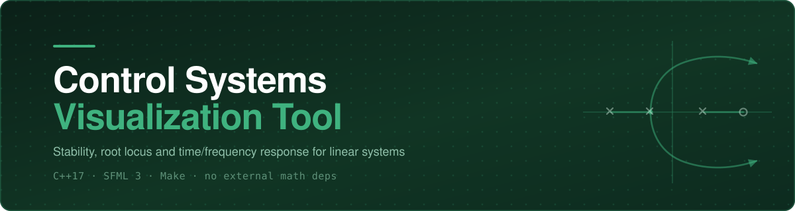
</p>

<p align="center">
  
  
  
  
</p>

A C++ desktop tool for analyzing and visualizing linear control systems — stability, root locus, and step/impulse response — without doing the linear algebra by hand.

<p align="center">
  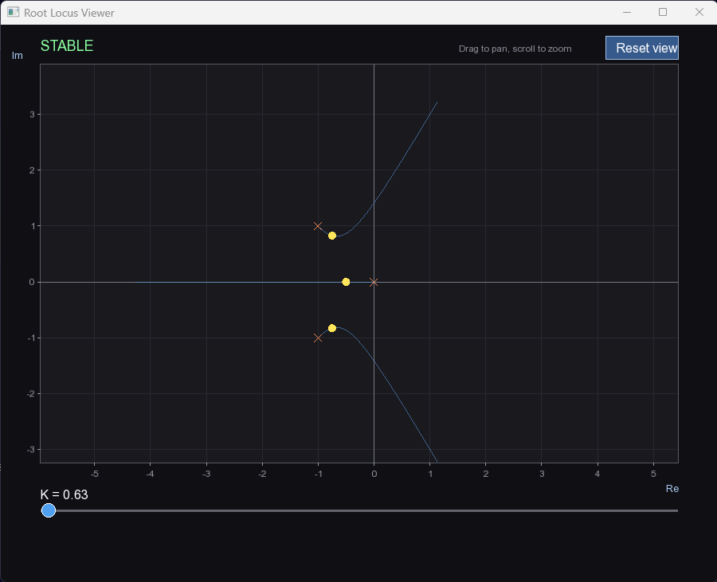
</p>

<p align="center"><sub>Root locus with a live K slider — closed-loop poles redraw as K sweeps, green for stable, red for unstable.</sub></p>

---

**Contents** · [Why this exists](#why-this-exists) · [Features](#features) · [Walkthrough](#walkthrough) · [Tech stack](#tech-stack) · [Architecture](#architecture) · [Getting started](#getting-started)

---

## Why this exists

Built alongside a university Control Systems course, following specific techniques from the course's own guide and from a Numeric Methods course: **Faddeev–LeVerrier** for the characteristic polynomial, **Durand–Kerner** for polynomial root-finding, **Controllable Canonical Form** for state-space realization, **Routh–Hurwitz** for stability.

Doing this analysis by hand for anything past a 3rd-order system means grinding through matrix determinants, polynomial root-finding and a Routh table just to answer *"is this stable"* or *"what does the root locus look like as K grows"* — and one wrong arithmetic step invalidates everything after it.

This tool does the actual math instead of a lookup table or a canned example, and lets you **see** the result instead of squinting at a printed list of complex numbers.

## Features

### Two system representations

Describe a system as state-space matrices (A, B, C, D) or as transfer function coefficients, and convert freely between the two (Faddeev–LeVerrier / Controllable Canonical Form).

### Stability analysis

Full Routh–Hurwitz table, right-half-plane root count, and a stable / marginally-stable / unstable verdict.

### Interactive root locus

Branches are tracked by predictive extrapolation as K sweeps, so they don't swap identity near breakaway/break-in points. A live K slider shows the current closed-loop poles and stability in real time. The view auto-fits to the system's poles and zeros — even when they are orders of magnitude apart — and you can drag to pan, scroll to zoom, and hit **Reset view** to snap back.

### Step and impulse response

Numerically simulated from the state-space model (fourth-order Runge–Kutta) and plotted as a time-domain graph, with the same auto-fit, pan and zoom.

### Frequency response

Bode (magnitude and unwrapped phase on a logarithmic frequency axis), Nichols and Nyquist, on tabs of one window. The frequency range is picked automatically from the poles and zeros — two decades below the slowest, two above the fastest. A K slider moves the curves live, and a corner panel shows the gain and phase margins (ω_t, γ_k, ω_-π, m_k, K_critic) plus three closed-loop verdicts that must agree: the margins, the Nyquist encirclement count, and Routh–Hurwitz.

### Numbered axes

Every plot has a grid and tick labels at round values (1, 2, 5 × a power of ten) that follow the view as you pan and zoom.

### Two ways to run it

A point-and-click GUI with no console at all for quick use, or a console menu for anyone who'd rather type values at a prompt.

## Walkthrough

### Choosing how to describe the system

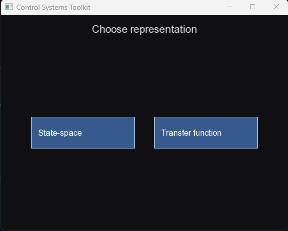

Every analysis starts here: describe the system as state-space matrices, or as a transfer function's coefficients.

### Transfer function input

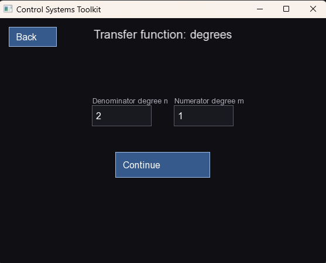

First pick the numerator/denominator degrees...

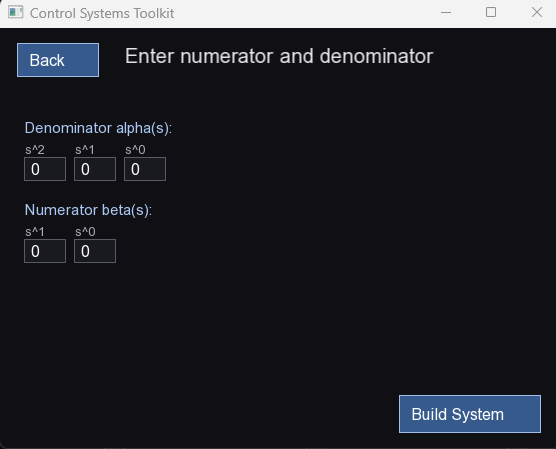

...then enter alpha(s) and beta(s) coefficient by coefficient.

### State-space input

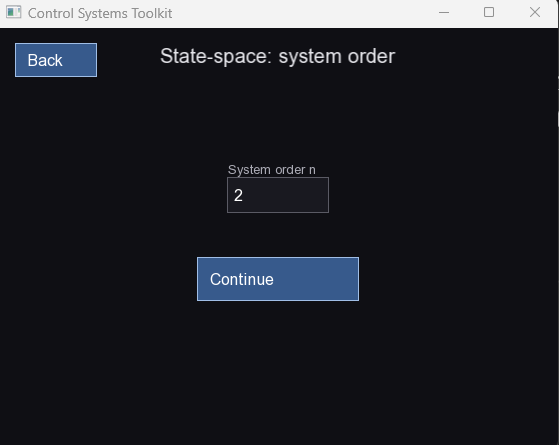

For state-space, pick the system order n first...

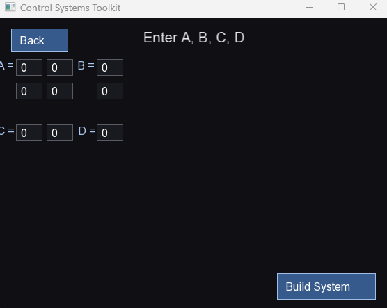

...then fill in A, B, C, and D.

### Choose what to check

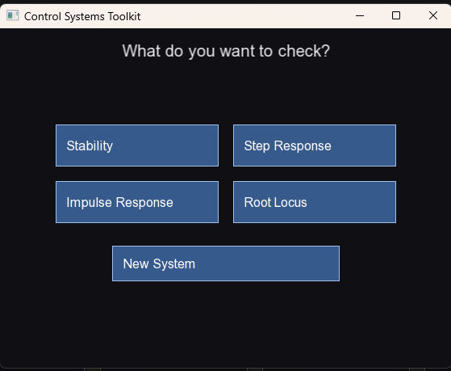

Once the system is built, pick an analysis. "New system" resets back to step 1 without closing the app.

### Stability

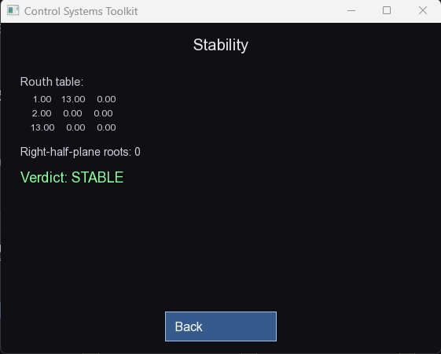

Runs the Routh–Hurwitz table and reports the verdict (stable / marginally stable / unstable) along with the right-half-plane root count.

### Step response

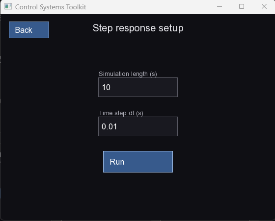

Set the simulation length and time step...

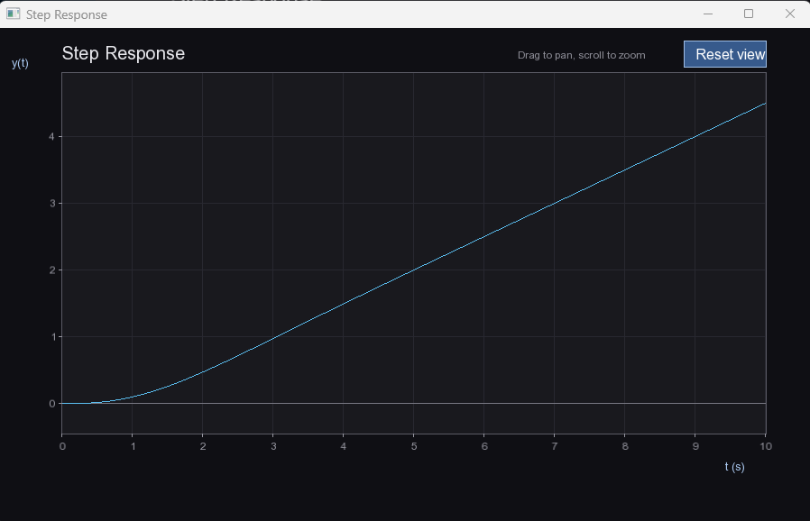

...then see y(t) plotted.

### Impulse response

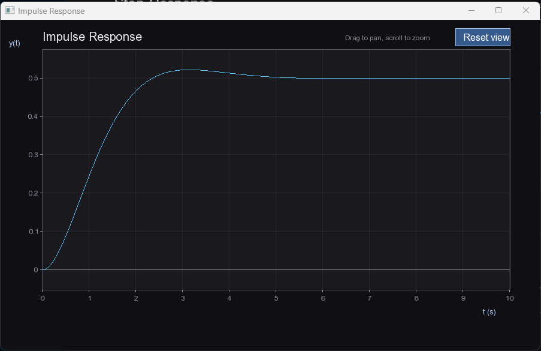

Impulse response follows the same two screens as the step response: the same setup screen, then y(t) plotted with the same auto-fit, pan and zoom.

### Root locus


The closed-loop pole trajectories for K in [0, Kmax], with a draggable slider that moves K and redraws the current closed-loop poles live — color-coded green/red for stable/unstable as you cross a stability boundary.

### Frequency response

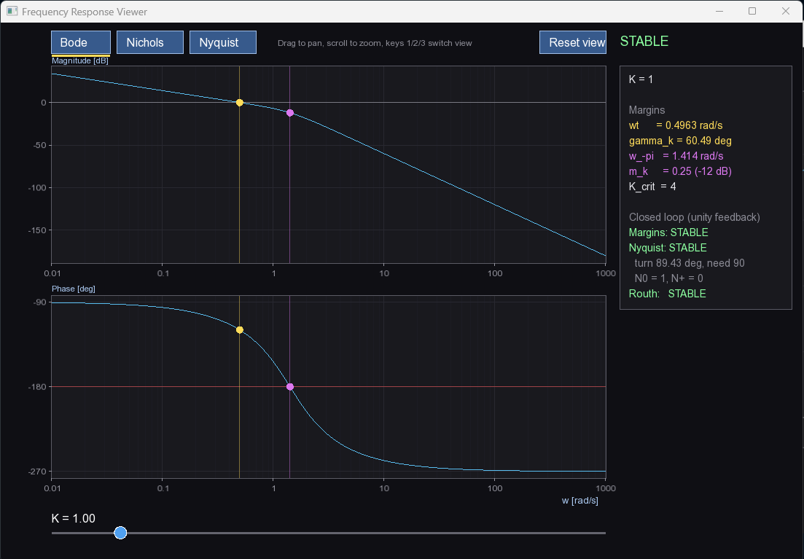

Bode magnitude and phase on a logarithmic frequency axis. The frequency range is picked automatically from the poles and zeros, and the K slider moves the curve live. The corner panel lists the crossover frequencies and margins (ω_t, γ_k, ω_-π, m_k, K_critic), marked on the plots, plus three closed-loop verdicts: from the margins, from counting the Nyquist encirclements, and from Routh–Hurwitz.

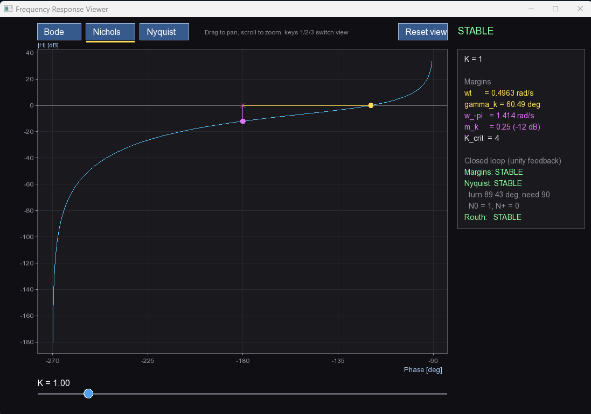

The same data as Nichols (phase on x, magnitude in dB on y). The critical point is (−180°, 0 dB); γ_k is the horizontal distance to it and m_k the vertical one.

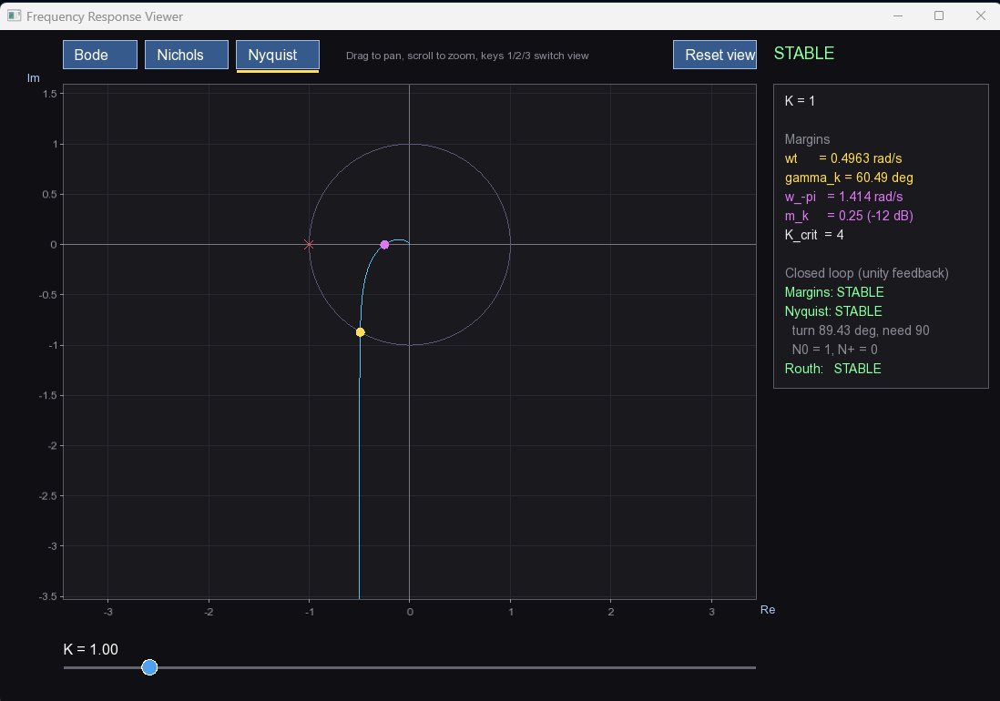

And as Nyquist, in the complex plane, with the unit circle and the critical point −1. Switch between the three views with the tabs or the keys <kbd>1</kbd> / <kbd>2</kbd> / <kbd>3</kbd>.

### The console alternative

`main.exe` offers the exact same analysis through a typed menu instead of buttons — useful for scripting, quick one-off checks, or just preference. Both entry points share the same underlying math and the same plot windows, so results are identical either way.

## Tech stack

| Layer | Technology |
|---|---|
| Language | C++17 |
| Graphics / UI | SFML 3 |
| Build | Make (Makefile, g++) |
| Target platform | Windows (MSYS2 / MinGW64) — plain g++ + SFML works elsewhere too |

## Architecture

```
Control-Systems-Visualization-Tool
├── include/
│   ├── math/      # ComplexNumber, Matrix, Polynomial
│   ├── control/   # TransferFunction, StateSpace, Conversions, Stability,
│   │              # RootLocus, TimeResponse, FrequencyResponse
│   └── view/      # Plot, Slider, Button, TextField, Font, RootLocusWindow,
│                  # TimeResponseWindow, FrequencyWindow, LauncherWindow
├── src/           # mirrors include/, plus the two entry points:
│   ├── main.cpp       # console menu                            -> main.exe
│   └── main_gui.cpp   # point-and-click launcher, no console    -> gui.exe
├── test/
│   └── test_math.cpp  # validation against known analytical results — no SFML needed
└── Makefile
```

**`math/`** — general-purpose linear algebra and polynomial root-finding (Durand–Kerner). No control-theory knowledge lives here.

**`control/`** — the actual control-systems algorithms: Routh–Hurwitz stability, root locus (with branch identity tracking via the Hungarian algorithm), time-response simulation (RK4), frequency response (log-spaced grid, phase unwrapping, margins found by bracketing + bisection on the computed samples, Nyquist encirclement counting), and the two representation conversions.

**`view/`** — everything SFML-specific: a reusable `Plot` (world↔screen mapping, pan/zoom, grid and numbered axes, clipping to its frame), `Button` / `TextField` / `Slider` widgets, and the windows built from them. `LauncherWindow` is the whole point-and-click app; `RootLocusWindow` and `TimeResponseWindow` are the plot windows both entry points share.

## Getting started

### Prerequisites

- A C++17 compiler — MSYS2 MinGW64 `g++` on Windows, or plain `g++` / `clang++` elsewhere
- SFML 3 — on MSYS2 MinGW64: `pacman -S mingw-w64-x86_64-sfml`

### Build

```bash
make main   # console menu        -> main.exe
make gui    # point-and-click app -> gui.exe
```

`make clean` removes all build output. `make test_math` builds the math/control validation suite, which has no SFML dependency and always builds even without SFML installed — useful after touching anything under `math/` or `control/`.

### Run

```bash
./gui.exe    # recommended: point-and-click, no console
./main.exe   # console menu
```

On Windows, `gui.exe` has no console window at all, so double-clicking it from Explorer works directly. If you run it from a terminal instead, make sure the SFML DLLs (`C:\msys64\mingw64\bin`) are reachable — either launch it from the MSYS2 MINGW64 shell, or copy the DLLs next to the `.exe`.

## Status

A personal project built alongside a university Control Systems course. Feedback and suggestions are welcome.

---

<p align="center">
  <a href="https://github.com/raulpop-codes"></a>
</p>
